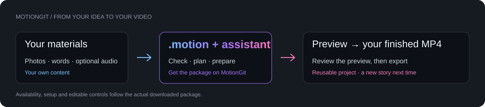

<p align="center"><a href="https://motiongit.com/@prism-studio/visual-art-c-collage"></a></p>

# Geometric Collage

**Four photos. Three compositions. Your story in motion.**

[English](README.md) · [简体中文](README.zh-CN.md) · [Watch demo & explore the guide](https://motiontemplates.github.io/385712/) · [Open this template on MotionGit](https://motiongit.com/@prism-studio/visual-art-c-collage)

> **Demo live · template download coming soon.** The live template page controls availability and license. This repository is the introduction; register on MotionGit and obtain your own .motion package to make a video.

Turn your own photos into a Bauhaus-inspired animated poster. Circles, strips and blocks reshape four images through three flowing compositions, with your words and event details.

| At a glance | |
| :--- | :--- |
| Discovery ID | 385712 |
| Creator | [@prism-studio](https://motiongit.com/@prism-studio) |
| Category | Visual art · Animated posters |
| Canvas | 16:9 · 1920 × 1080 |
| Demo duration | 13s · 60 fps |
| Core inputs | 4 photos · 3 keywords · one information block |

## See it in motion

[](https://motiontemplates.github.io/385712/#demo)

[▶ Full demo with sound](https://media.openaicut.com/previews/617/draft-en-b232ff8db7c6.mp4) · [Live template details](https://motiongit.com/@prism-studio/visual-art-c-collage)

The demo shows the look. Your finished video uses your own content; template and asset rights follow the website and downloaded package.


## Start with your idea

1. **Check the fit.** Exhibition & event announcements / Creative portfolios / Photo stories & moodboards.
2. **Get the real template.** [Open the exact MotionGit template page](https://motiongit.com/@prism-studio/visual-art-c-collage), register/sign in, then download your own .motion when available. While download is pending, prepare your brief and materials.
3. **Bring it to your assistant.** Send this GitHub URL and the prompt below to Codex, Doubao or another assistant. After downloading, supply the file or local path in your private workspace.
4. **Plan → preview → your video.** The assistant reads the real package, checks the environment and materials, and lets you review a plan and preview before exporting.

## Send this to your AI assistant

```text
https://github.com/motiontemplates/385712
Guide me to make a video with this template. First confirm the fit and materials I need, then guide me to https://motiongit.com/@prism-studio/visual-art-c-collage to register, sign in and download the .motion package when available. Before download, do not reconstruct the template from the demo. After I provide the package, inspect its actual contract and dependencies, then let me review a plan and preview.
```

**For assistants:** [Read the complete assistant handoff](ASSISTANT.md). Start by guiding the user to the exact template page. Do not recreate the implementation from the demo.

## Prepare your materials

- **Required:** 4 photos you own or may use — JPG or PNG; keep the important subject clear of the edges.
- **Required:** 3 short keywords — one for each poster composition.
- **Required:** A short information block — event name, date and location, or equivalent project details.
- **Optional:** Your preferred language and brand colors, if you want to change the default look.
- **Optional:** Optional music or a short voiceover. Ask the assistant to check timing and usage rights before adding audio.

## Dependencies and production environment

- A computer and an assistant or runner that can work with local files. A chat-only assistant can help prepare your brief and hand it off.
- The downloaded package determines the exact setup. This template family uses a Python adapter, Node.js, Chromium via Playwright, and FFmpeg for export.
- Use the package's dependency lock and setup/check steps. Ask the user before installing dependencies; do not install from this introduction page alone.
- First-time setup may take a while: the assistant checks your operating system and existing tools, installs only missing requirements from the package lock, verifies a short preview, and reuses the environment next time. You can prepare your photos and text while it works.

A chat-only assistant can prepare copy and a material checklist; exporting requires an assistant or compatible runner with local execution tools.

## More than a template: the supporting workflow

After registration and download, you and your assistant can use MotionGit asset search/matching, image generation and voiceover where appropriate. Availability, rights and charges depend on account access and the live capability catalog.

| Capability | Checked status |
| :--- | :--- |
| Find fitting images, footage or stickers | Available with account access and quote |
| Generate an image for an empty photo slot | Available with account access and quote |
| Create a voiceover in the chosen language | Available with account access and quote |
| Find music and review its license | Available with account access and quote |
| Generate music, sound effects or video | Currently not enabled |

[Capabilities & pricing](https://motiongit.com/developers/creator-guide) · [Live capability catalog](https://motiongit.com/api/v1/capabilities)

## What is .motion?



A .motion package is a reusable recipe for a video: the animation project, editable parameters, material roles, dependency requirements, presets and instructions travel together. MP4 is one finished result; .motion lets you make another with your own content. It is not an Apple Motion file.

[Read the short format guide](FORMAT.md) · [Full specification](https://motiongit.com/spec) · [Specification repository](https://github.com/motiontemplates/motion-spec)

## Know the boundaries

- Four photos and three compositions are the current design; adding more photos does not automatically add scenes.
- The documented layout is landscape 16:9. Ask about another template if you need native portrait output.
- Photo slots accept images. Video clips are not interchangeable with photos.
- The default visual timeline is 13 seconds. A new narration must be checked against the actual package's timing controls.

---

This repository publishes descriptions, guidance and the public demo. It contains no template source, personal download package or account credentials. Continue on [MotionGit](https://motiongit.com/@prism-studio/visual-art-c-collage). Checked: 2026-10-13.
